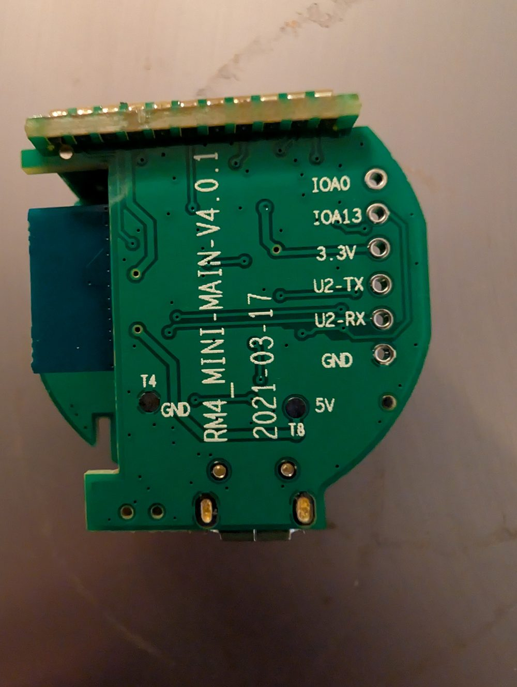
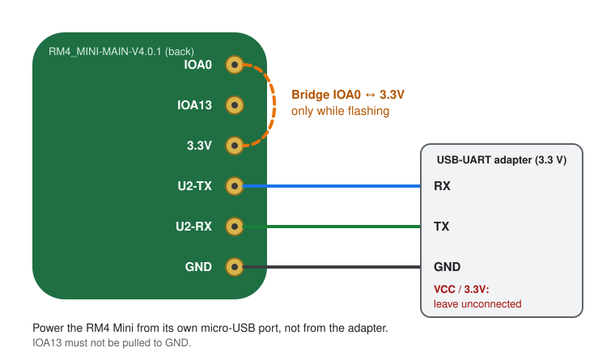

# ESPHome for the Broadlink RM4 Mini / RM4C Mini

Part of [ESPHome-Broadlink-RM4](../../README.md).

Local, cloud-free firmware for the Broadlink RM4 Mini and RM4C Mini. After
flashing, the little IR blaster shows up in Home Assistant as an **infrared
emitter** and an **infrared receiver** on Home Assistant's native `infrared`
platform. Everything that builds on that platform can use it right away, for
example [HAIR](https://github.com/DAB-LABS/HAIR) or the LG and Samsung
infrared integrations.

- [Features](#features)
- [Supported hardware](#supported-hardware)
- [Pin map](#pin-map)
- [Flashing](#flashing)
- [Configuration, Home Assistant and troubleshooting](#configuration-home-assistant-and-troubleshooting)
- [Known limitations](#known-limitations)

## Features

- Send IR codes with ESPHome's own `remote_transmitter` (hardware PWM
  carrier, non-blocking, so Wi-Fi keeps running while long codes go out)
- Receive IR codes from any remote with `remote_receiver`, including a small
  fix that makes interrupt-driven pins work on this chip
  ([details](../configuration.md#the-receiver-fix))
- Both exposed to Home Assistant as native infrared entities through
  `ir_rf_proxy`, no custom code or lambdas
- Status LED and the physical button
- OTA updates after the first flash, the case stays closed from then on
- One small device file per RM4, all hardware settings come from this
  repository as ESPHome packages

## Supported hardware

| | |
|---|---|
| Devices | Broadlink RM4 Mini, Broadlink RM4C Mini |
| Main board | `RM4_MINI-MAIN-V4.0.1` (printed on the back of the PCB) |
| Wi-Fi module | BL3357-P with a **Realtek RTL8720CF** (ARM Cortex-M33, 100 MHz, 2 MB flash) |
| Platform | ESPHome via [LibreTiny](https://github.com/libretiny-eu/libretiny), board `generic-rtl8720cf-2mb-992k` |

Broadlink has changed the internals over the years. Check the board marking
and the module before you order a UART adapter: other chips need a different
firmware. Looking for the RM4 Pro (same chip, plus 433 MHz RF)? See the
[RM4 Pro page](rm4-pro.md).

## Pin map

Taken from the boot log of the stock firmware, as documented in
[phdindota/broadlink-rm4mini-esphome](https://github.com/phdindota/broadlink-rm4mini-esphome):

| Function | Pin | Used here | Notes |
|---|---|---|---|
| IR transmitter (carrier) | `PA4` | yes | `remote_transmitter`, 38 kHz, 50 % duty |
| IR receiver (data) | `PA18` | yes | `remote_receiver` |
| Status LED | `PA7` | yes | inverted (on = low) |
| Button | `PA19` | yes | inverted, internal pull-up |
| Network button | `PA15` | no | listed by the stock firmware; it is also the RX line of the flashing UART (UART2) |
| Temperature/humidity (SHT30) | soft I²C | no | the stock firmware has support enabled, the pins are still unknown |

<details>
<summary>Relevant part of the stock boot log</summary>

```text
[APP]==== rmparam in profile ====
[APP]app_network_pin 15
[APP]app_keypad_pin  19
[APP]th_support 1
[APP]energy_support 0

[APP]==== irda in profile ====
[APP]is_support 1
[APP]capin_work_level 0
[APP]carrier_pin 4
[APP]data_pin 18
[APP]data_gpt 8
[APP]carrier_gpt 1
[APP]carrier_gpt_channel 4
[APP]led_pin 7

[APP]==== rf in profile ====
[APP]is_support 0
```

</details>

Test points on the back of the board: `IOA0`, `IOA13`, `3.3V`, `U2-TX`,
`U2-RX`, `GND` (in one row along the edge) plus `5V`, `T4` and `T8`.

## Flashing

The first flash needs the serial port on the board. Every later update goes
over Wi-Fi.

### 1. Open the case

Peel off the rubber pad on the bottom of the device. The screws are hidden
underneath. Remove them and separate the two halves of the case. Keep the pad
to put it back afterwards.

### 2. Connect the UART adapter

<p align="center">
  
</p>

The six test points along the edge of the board are plated through-holes.
Solder short wires to `U2-TX`, `U2-RX` and `GND`, or hold pin headers or pogo
pins in place if you don't want to solder.

<p align="center">
  
</p>

| UART adapter | Board pad |
|---|---|
| GND | `GND` |
| TX | `U2-RX` |
| RX | `U2-TX` |
| 3.3V / VCC | **leave unconnected** |

Power the RM4 from its own USB cable. The adapter's 3.3 V output is usually
too weak for the Wi-Fi module and causes failed reads and writes.

### 3. Enter download mode

1. Bridge `IOA0` to `3.3V` with a short wire. The RTL8720C enters download
   mode when this pin is pulled **high** at power-up (not to GND like an
   ESP8266).
2. Make sure `IOA13` is not connected to GND.
3. Unplug and replug the USB power of the RM4.

### 4. Back up the stock firmware

Install ltchiptool (`pip install ltchiptool`, or the
[Windows GUI](https://github.com/libretiny-eu/ltchiptool/releases/latest)) and
read the complete flash:

```bash
ltchiptool flash read -d /dev/ttyUSB0 rtl8720c rm4mini-stock.bin
```

On Windows the port is called `COM3` or similar instead of `/dev/ttyUSB0`.
Keep this file. It is the only way back to the Broadlink firmware.

### 5. Build the firmware

**ESPHome dashboard (Home Assistant app)**

1. Create a new device with **+ New device**. The board type you pick in the
   wizard doesn't matter, the config gets replaced in the next step.
2. Open the new config with **Edit**, replace everything with the content of
   [`rm4-mini.example.yaml`](../../rm4-mini.example.yaml) and adjust the names at the top.
3. Add the keys from [`secrets.yaml.example`](../../secrets.yaml.example) to your
   secrets (**Secrets** in the top right corner of the dashboard).
4. **Install** → **Manual download** → **UF2 package (recommended)**.

**ESPHome command line**

```bash
git clone https://github.com/seb5594/ESPHome-Broadlink-RM4-Remote-Firmware.git
cd ESPHome-Broadlink-RM4-Remote-Firmware
cp secrets.yaml.example secrets.yaml           # fill in your values
cp rm4-mini.example.yaml my-rm4.yaml           # adjust name and friendly_name
esphome compile my-rm4.yaml
```

The image ends up as `.esphome/build/<name>/.pioenvs/<name>/firmware.uf2`.

### 6. Flash

With `IOA0` still bridged to `3.3V`, power-cycle the RM4 once more and write
the UF2 file:

```bash
ltchiptool flash write -d /dev/ttyUSB0 broadlink-rm4c-mini.uf2
```

ltchiptool detects the file type and writes bootloader, partition table and
firmware to the right offsets. The full image
`image_flash_is.0x000000.bin` from the same build folder works as well.

### 7. First boot

Remove the bridge between `IOA0` and `3.3V`, disconnect the UART adapter and
power-cycle the RM4. It connects to your Wi-Fi and Home Assistant discovers it
within a minute. Close the case.

From now on, **Install** → **Wirelessly** in the dashboard (or
`esphome run my-rm4.yaml`) updates the device over the air.

To go back to the Broadlink firmware, repeat steps 2, 3 and 6 with
`rm4mini-stock.bin`. ltchiptool recognizes its own dumps.

## Configuration, Home Assistant and troubleshooting

These parts are the same for all devices of this repository and live in the
shared docs:

- [ESPHome configuration](../configuration.md): the layers behind
  `rm4-mini.yaml`, the receiver fix and how to customize your device
- [Home Assistant and HAIR](../home-assistant.md): entities, learning a
  remote, moving codes over from the Broadlink integration
- [Troubleshooting](../troubleshooting.md)

## Known limitations

- The SHT30 temperature/humidity input of the stock firmware is not mapped
  yet; its pins are unknown.
- `PA15` (network button of the stock firmware) is left alone because it is
  also the RX line of the flashing UART.
- The RM4 Mini has no RF hardware. For 433 MHz look at the RM4 Pro.
- Hardware UART logging stays off, see
  [`logger`](../configuration.md#logger).
